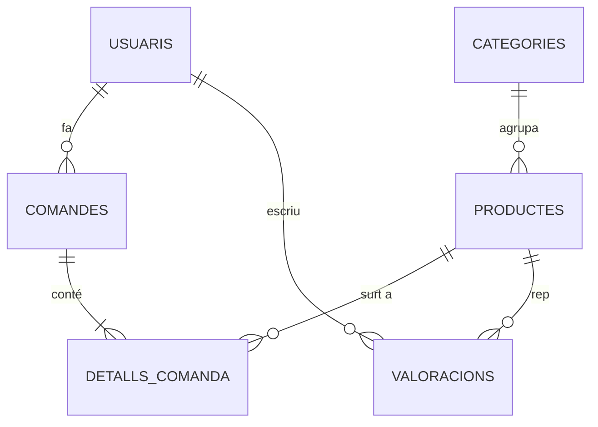

# BotigaTech


BotigaTech és la botiga online de components d'informàtica que hem fet amb **PHP**, **MySQL** i **Bootstrap**. És el nostre projecte final lliure del cicle ASIX a l'ITIC Barcelona.

Hem fet que els clients es puguin registrar, buscar productes al catàleg, valorar-los amb estrelles, afegir-los a la cistella i fer comandes. L'administrador pot gestionar productes i categories, canviar l'estat de les comandes i consultar estadístiques de la botiga.

**Un cop instal·lada, s'hi entra des d'aquí** (cal tenir Apache i MySQL encesos):
[http://localhost/Projecte_Final_PHP_Eric_Robert_Miquel_Molina/botigatech/](http://localhost/Projecte_Final_PHP_Eric_Robert_Miquel_Molina/botigatech/)

---

## Què hem fet

### Part del client
- Registre i login amb validacions.
- Catàleg amb **cerca** per nom o marca, filtre per categoria i preu màxim, i opció de veure només els productes disponibles.
- **Ordenació** dels productes: primer els disponibles i després per preu (també es pot ordenar per nom o per valoració).
- **Paginació** al catàleg (6 productes per pàgina).
- Fitxa de producte amb valoracions de 1 a 5 estrelles i comentari.
- Cistella de la compra i confirmació de la comanda.
- Historial de comandes, on es poden cancel·lar les que estan pendents.

### Part de l'administrador
- **CRUD de productes** (crear, veure, modificar i eliminar), amb **pujada d'imatge** (jpg, png o webp, màxim 2 MB).
- **CRUD de categories**.
- Gestió de totes les comandes: filtre per estat o per client i canvi d'estat (pendent, enviada, entregada, cancel·lada).
- **Estadístiques**: vendes totals, comandes per estat, productes més venuts i més ben valorats.
- **Vista client**: amb el botó groc del header l'administrador pot veure la botiga com la veu un client, sense deixar de ser administrador.

### Part comuna
- Les contrasenyes es guarden encriptades amb `password_hash` i es comproven amb `password_verify`.
- Gestió de sessions i logout que destrueix la sessió.
- Control d'accés segons el rol: si no hi ha sessió, redirigeix a `login.php`, i si l'usuari no té el rol necessari surt un error 403.
- Header dinàmic: sense login mostra el nom de l'aplicació, i amb login mostra el nom, el correu i el rol.
- Un `error.php` amb missatges específics per a cada situació (accés denegat, no trobat, estoc insuficient, no es pot eliminar si té elements relacionats...).

---

## Usuaris de prova

| Rol | Correu | Contrasenya |
|---|---|---|
| Administrador | `admin@test.com` | `admin123` |
| Client | `usuari@test.com` | `12345678` |
| Client | `pau@test.com` | `12345678` |
| Client | `laia@test.com` | `12345678` |

---

## Com instal·lar-ho

Cal tenir **XAMPP** o **Laragon** (Apache + PHP + MySQL).

1. Copiem la carpeta del projecte a `htdocs` (XAMPP) o a `www` (Laragon).
2. Importem el fitxer `botigatech/database.sql` des de **phpMyAdmin** (pestanya *Importar*) o des d'HeidiSQL. Crea la base de dades `botigatech` amb dades d'exemple, i si ja existia l'esborra i la torna a crear.
3. Si el nostre MySQL no és el per defecte, canviem les dades de `botigatech/conexio.php` (per defecte: `localhost`, usuari `root` i sense contrasenya).
4. Obrim el navegador a [http://localhost/Projecte_Final_PHP_Eric_Robert_Miquel_Molina/botigatech/](http://localhost/Projecte_Final_PHP_Eric_Robert_Miquel_Molina/botigatech/).

Hem inclòs Bootstrap a la carpeta `assets`, així que l'aplicació funciona també sense connexió a internet.

---

## Base de dades

Hem creat **6 taules** relacionades, amb claus primàries i foranes (InnoDB) i 37 registres d'exemple.



Hem fet servir diferents tipus de dades: `INT`, `VARCHAR`, `TEXT`, `DATE`, `DATETIME`, `ENUM` i `DECIMAL`.

---

## Com està organitzat el projecte

```
botigatech/
├── database.sql              Base de dades (DROP, CREATE i INSERT)
├── index.html                Pàgina de presentació
├── conexio.php               Connexió a la BD (mysqli)
├── funcions.php              Funcions comunes
├── header.php / footer.php   Capçalera dinàmica i peu de pàgina
├── error.php                 Gestió d'errors
├── registre.php  login.php  logout.php  acces.php  canvia_vista.php
├── cataleg.php  producte.php  cistella.php  comandes.php  comanda.php
├── admin_productes.php  producte_form.php  producte_eliminar.php
├── admin_categories.php  categoria_form.php  categoria_eliminar.php
├── admin_comandes.php  admin_estadistiques.php
├── assets/                   CSS, JS (Bootstrap) i imatges
└── uploads/                  Imatges de productes pujades
```

---

## Seguretat

Hem tingut en compte aquests punts:

- Fem servir **prepared statements** de mysqli per evitar la injecció SQL.
- Tot el que mostrem a la pàgina passa per `htmlspecialchars`, per evitar XSS.
- L'ordenació del catàleg es fa amb una llista de camps permesos.
- Les accions que canvien dades (eliminar, cancel·lar, canviar estat) només s'accepten per `POST`.
- Confirmar i cancel·lar una comanda es fa amb **transaccions**, perquè l'estoc quedi sempre correcte.
- Les imatges que es pugen es validen amb `getimagesize`, el tipus i la mida.

---

## Autors

Som l'Èric Robert i en Miquel Molina, alumnes d'ASIX a l'ITIC Barcelona.
